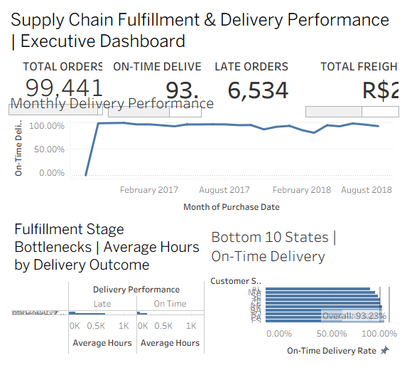

# Supply Chain Fulfillment & Delivery Performance Analytics

### An SQL-Based Framework for Identifying Service Gaps, Operational Bottlenecks, and Cost Drivers

**Tools:** PostgreSQL | SQL | Tableau | Data Visualization | Supply Chain Analytics

**Dataset:** Olist Brazilian E-Commerce Public Dataset (Historical)

---

## 1. Executive Summary

This project examines end-to-end order fulfillment and delivery performance using 99,441 historical e-commerce orders.

The objective is to identify delivery reliability gaps, evaluate operational bottlenecks, analyze freight costs, and translate transactional data into actionable supply chain insights.

Using PostgreSQL for data preparation and analysis, and Tableau for executive reporting, the project demonstrates how operational data can support performance monitoring and continuous improvement.

## 2. Business Problem

Supply chain leaders need reliable visibility into order fulfillment performance to answer critical operational questions:

- What percentage of customer orders arrive on or before the estimated delivery date?
- How many deliveries miss their promised dates?
- Which fulfillment stages show the largest differences between on-time and late orders?
- Which geographic markets consistently underperform?
- What is the overall freight cost associated with the order portfolio?

This analysis develops a performance-monitoring framework around these questions.

## 3. Executive Performance Indicators

| KPI | Result |
|---|---:|
| Total Orders | 99,441 |
| Delivered Orders | 96,478 |
| Order Completion Rate | 97.02% |
| Evaluated Deliveries | 96,470 |
| On-Time Delivery Rate | 93.23% |
| Late Deliveries | 6,534 |
| Average Delay Among Late Deliveries | 10.62 days |
| Total Freight Charges | R$2.25 million |
| Freight-to-Product Value Ratio | 16.57% |

**Metric definition:** On-time delivery is measured by comparing actual delivery dates against estimated delivery dates for orders with the required delivery information.

## 4. Analytical Approach

### Data Preparation and SQL

Nine related Olist datasets were loaded into PostgreSQL and analyzed using relational SQL.

The workflow included:

1. Exploring order, customer, seller, product, payment, and delivery data.
2. Joining related transactional tables while controlling for duplicate order records.
3. Creating reusable SQL views for order-level performance reporting.
4. Calculating fulfillment, delivery reliability, and freight metrics.
5. Exporting an executive reporting dataset for Tableau.

The executive reporting view was validated at **one record per order**, preserving the 99,441-order population.

### Tableau Dashboard

The executive dashboard presents:

- Four headline operational KPIs.
- Monthly on-time delivery trends.
- Fulfillment-stage comparisons for on-time versus late deliveries.
- The ten states with the lowest on-time delivery rates.
- An overall delivery-performance benchmark.

## 5. Key Findings

### Finding 1 — Delivery Reliability

The overall on-time delivery rate was **93.23%**, with **6,534 late deliveries** among 96,470 evaluated deliveries.

Late deliveries averaged approximately **10.62 days beyond their estimated delivery dates**.

### Finding 2 — Fulfillment Bottlenecks

Orders delivered late exhibited substantially longer average processing and transportation times.

| Fulfillment Stage | Late Orders | On-Time Orders |
|---|---:|---:|
| Approval to Carrier | 133.78 hours | 63.68 hours |
| Carrier to Customer | 669.32 hours | 191.64 hours |

The carrier-to-customer stage showed the largest difference, making transportation lead time an important area for further operational investigation.

These comparisons identify associations, not proven causes of late delivery.

### Finding 3 — Geographic Performance Gaps

The ten lowest-performing states fell below the overall on-time delivery benchmark of 93.23%.

Examples include:

- **Alagoas (AL):** 78.59% on-time delivery across 397 evaluated orders.
- **Maranhão (MA):** 82.57% across 717 evaluated orders.
- **Rio de Janeiro (RJ):** 87.89% across 12,350 evaluated orders.

Rio de Janeiro is especially relevant for further investigation because its below-benchmark performance affects a comparatively large order volume.

Results from low-volume states should be interpreted cautiously.

### Finding 4 — Freight Cost Visibility

Total freight charges amounted to approximately **R$2.25 million**, representing **16.57% of total product value**.

This establishes a baseline for further analysis of transportation costs by geography, seller, and delivery outcome.

## 6. Business Recommendations

**1. Prioritize transportation lead-time analysis.** Investigate carrier performance, shipping distances, delivery regions, and service-level variation to better understand delays in the carrier-to-customer stage.

**2. Target high-impact geographic markets.** Prioritize states with both below-benchmark delivery performance and meaningful order volumes.

**3. Introduce proactive exception monitoring.** Track orders approaching their estimated delivery dates and flag fulfillment or transportation delays for earlier intervention.

**4. Establish recurring performance reviews.** Monitor on-time delivery, late-order volume, fulfillment-stage lead times, and freight costs through a consistent executive KPI framework.

**5. Expand freight efficiency analysis.** Evaluate cost-to-serve patterns alongside service outcomes before recommending specific transportation cost reductions.

## 7. Project Deliverables

This repository is intended to contain:

- Documented PostgreSQL queries and analytical views.
- SQL data-validation and KPI calculations.
- A Tableau packaged workbook (`.twbx`).
- An executive dashboard screenshot.
- Data dictionary and methodology documentation.
- Business findings and recommendations.

## 8. Data Source and Limitations

**Source:** Public Olist Brazilian E-Commerce Dataset, available through Kaggle.

The dataset contains historical Brazilian e-commerce transactions and is used exclusively for independent portfolio analysis.

It does not contain proprietary data from The Home Depot or any other employer.

Important limitations include historical coverage, incomplete delivery records for some orders, varying state-level sample sizes, and the inability to establish causality from descriptive comparisons alone.

## 9. Skills Demonstrated

- SQL joins, aggregations, and reusable analytical views.
- Relational data modeling and order-level data validation.
- Supply chain KPI development.
- Fulfillment and transportation performance analysis.
- Geographic and time-series analysis.
- Tableau executive dashboard design.
- Business problem-solving and data-driven recommendations.

---

**Project Type:** Independent Supply Chain Analytics Portfolio Project

**Author:** Dwight Jones

**Focus Areas:** Supply Chain Analytics | Operations Analytics | Business Intelligence | Continuous Improvement

## Executive Dashboard

[Download the Tableau Packaged Workbook](tableau/Supply_Chain_Fulfillment_Dashboard.twbx)
